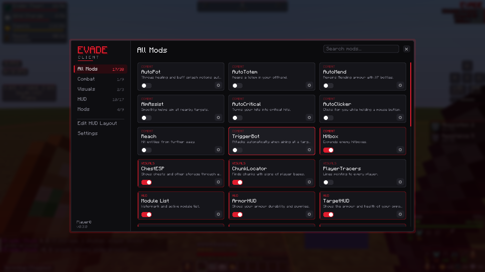

# Evade Client

A Fabric PvP client for **Minecraft 1.21.11** (Java 21).

> Most multiplayer servers ban modified clients like this one. Use it in singleplayer,
> on your own server, or on servers that allow it.

## Building

```bash
./gradlew build          # jar lands in build/libs/evade-client-<version>.jar
./gradlew runClient      # launches a dev Minecraft with the client loaded
```

Install by dropping the jar plus [Fabric API](https://modrinth.com/mod/fabric-api) into
`.minecraft/mods` with Fabric Loader 0.18+ for 1.21.11.

### In-game tests

```bash
xvfb-run ./gradlew runClientGameTest
```

Launches the real game, builds a test world and checks each module works: AutoTotem equips, AutoPot heals,
AutoMend repairs, Reach/Hitbox extend, TriggerBot kills, AimAssist locks on, Zoom/Freelook/Fullbright/
ToggleSprint/Time Changer work, and clicking a card in the menu toggles it. Screenshots land in
`build/run/clientGameTest/screenshots/`.

## Installer

`installer/` is **Evade Installer**, a standalone Swing app (no Minecraft dependencies) that players download
from evadeclient.com. It installs Fabric Loader, Fabric API and Evade into `.minecraft/evade` and adds an
"Evade Client" profile (with icon) to the official Minecraft Launcher, which handles login and launching.

```bash
./gradlew :installer:jar :installer:createExe   # EvadeInstaller.jar + Evade-Installer.exe (Launch4j)
java -jar installer/build/libs/EvadeInstaller.jar --cli [--dir PATH] [--memory GB] [--no-copy-settings]
java -jar installer/build/libs/EvadeInstaller.jar --screenshots OUTDIR   # render every screen to PNG
```

It reads `https://evadeclient.com/version.json` for the current Evade version and checksum, gets the newest
stable Fabric Loader from meta.fabricmc.net and Fabric API from Modrinth, and verifies every download.
`scripts/build-site.sh` builds both and publishes them to `site/downloads/`.

## Evade Clips

`clips/` is **Evade Clips**, a desktop app that records, stores and edits gameplay clips for any game: free
instant replays, recording while the replay buffer keeps running, automatic highlight detection, a timeline
editor and Discord/Shorts/GIF exports. Evade Client's **Clips** mod saves clips through it automatically on kills,
pops, deaths and wins. See [clips/README.md](clips/README.md).

## Using it



| Action | How |
|---|---|
| Open the menu | **Right Shift** (change it under *Settings*) |
| Toggle a mod | Click its card |
| Mod settings + keybind | Click the gear, or right-click the card |
| Search | Just start typing |
| Move / resize HUD | *Edit HUD Layout*: drag (snaps to edges, centre and other elements), scroll to resize, right-click for settings |

Keybind toggles show a slide-in notification. Chat commands (never sent to the server): `.help`, `.toggle`,
`.bind`, `.set`, `.modules`, `.save`, `.load`. Config: `config/evade/config.json`.

## Modules

### Combat
| Module | What it does |
|---|---|
| **AutoPot** | Throws splash healing below a health threshold (falls back to regen), and re-buffs strength/speed when they run out and fire res when burning. Looks down, throws, restores your slot and rotation in the same tick. Refills the hotbar from your inventory. |
| **AutoTotem** | *Always*: re-equips the offhand totem instantly after a pop. *Smart*: only takes the offhand when you're low, falling or flying with an elytra, so you keep your shield/gapple otherwise. Optional backup totem in a hotbar slot. |
| **AutoMend** | Throws XP bottles at your feet when Mending armour drops below a threshold and keeps going until it's full. *Strip Repaired* takes off finished pieces so all the XP goes to damaged ones, then puts them back. Pauses when enemies are near or your health is low. |
| **AimAssist** | Per-frame, frame-rate-independent easing towards the nearest point of the target's hitbox. Movement is snapped to your mouse sensitivity like real input. FOV, range, priority (angle/distance/health), sticky lock, wall check. |
| **AutoCritical** | *Jump*: hops when you're about to hit and holds TriggerBot/AutoClicker swings until you're falling, so they land as real crits. *Packet*: tiny fake hop before each hit. Drops sprint before the hit, since sprinting cancels crits. |
| **AutoClicker** | Runs per frame for accurate CPS, with gaussian-randomised gaps and occasional pauses. Left and/or right click, *Smart Cooldown* for 1.9+ combat, doesn't interfere with mining. |
| **Reach** | Extends entity reach (3.0–6.0) with per-tick variance; optional block reach. |
| **TriggerBot** | Attacks when your crosshair is on a valid target and your weapon is charged. Random reaction delay and charge threshold, skips shield-blocking players unless you hold an axe. |
| **Hitbox** | Expands targets' hitboxes for your crosshair; optional outline display. |

All targeting modules share filters: players / mobs / animals, ignore teammates, ignore invisible.

### Render (all drawn through walls)
| Module | What it does |
|---|---|
| **ChestESP** | Chests (double chests merged), trapped chests, ender chests, shulkers in their own colour, barrels, hoppers, spawners. Outline/fill, tracers, distance fade. |
| **ChunkLocator** | Flags chunks that show signs of a base: stashes of storage, shulker boxes, rotated deepslate (natural deepslate is always vertical) and player-made blocks below y=0. Highlights the chunk, pings and posts the coordinates in chat. Uses palette checks, so scanning is cheap. |
| **PlayerTracers** | Lines from your crosshair to every player, coloured by distance or team. Optional boxes; your current fight target is highlighted. |

### HUD (drag and resize in *Edit HUD Layout*)
| Element | What it shows |
|---|---|
| **ArmorHUD** | Your armour and held items with durability %, a flashing warning at low durability, and counts of totems, gapples, pearls, wind charges, XP, pots, crystals, obsidian. |
| **TargetHUD** | Whoever you're fighting (last hit) or looking at (up to 64 blocks): face, name, animated health + absorption bar, distance, their armour with durability, held items, blocking/using status, and Winning/Losing. |
| **Cooldowns** | Timers for every item cooldown: ender pearl, wind charge, spear, chorus fruit, shield disabled by an axe, goat horn, and gapple cooldowns on servers that add them. Also shows weapon charge and effect timers (gapple absorption, regen, strength, speed, fire res, resistance). Flashes READY and pings when something comes off cooldown. |
| **Module List** | EVADE watermark and active cheats list (red wave, rainbow, static or white). |
| **Keystrokes** | WASD, LMB/RMB with CPS, space bar; keys flash red when pressed. |
| **CPS / FPS / Ping** | Clicks per second (left and right), frame rate, server latency. |
| **Coordinates** | XYZ, facing with axis, biome, optional Nether/Overworld conversion. |
| **Potion Effects** | Icons, levels and time left; blinks when about to expire; can hide the vanilla one. |
| **Direction HUD** | Compass strip with heading. |
| **Clock / Server Address / Memory / Speed** | Real time (12h/24h), server IP, RAM use, blocks per second. |
| **Reach Display / Combo Counter** | Distance of your last hit; hits in a row without being hit. |

Every HUD element has Scale and Background settings; text elements also have text colour and brackets.

### Mods (quality of life)
| Mod | What it does |
|---|---|
| **ToggleSprint** | Tap sprint (and optionally sneak) to toggle; shows the state on screen. |
| **Zoom** | Hold **C**; scroll to change the level; smooth zoom, lower sensitivity while zoomed, optional cinematic camera. |
| **Freelook** | Hold **Left Alt** to look around your player without turning. |
| **Fullbright** | See in the dark without touching your gamma setting. |
| **Crosshair** | Cross, dot, circle, cross + dot or T; size, gap, thickness, outline, colour; turns red on targets. |
| **No Hurt Cam** | Removes the screen shake when you're hit. |
| **Block Outline** | Colour, thickness and translucent fill for the block you're looking at. |
| **Time / Weather Changer** | Client-side time of day and weather. |
| **Clips** | Saves clips in Evade Clips on a key, or automatically on kills (multi-kills become one clip), totem pops of your target, deaths and wins. |

## Layout

```
net.evadeclient
├── EvadeClient          entrypoint: tick, HUD and world-render hooks
├── module/              Module, HudElementModule, TextHudModule, ModuleManager,
│                        combat/ render/ hud/ mods/ client/
├── setting/             Boolean / Number / Mode settings
├── gui/                 EvadeMenu (sidebar, search, cards, settings) and HudEditorScreen
├── hud/                 HUD rendering helpers
├── render/              through-wall line/box drawing (custom no-depth pipelines)
├── util/                inventory, rotations, targets, cooldowns, target tracking
├── command/ config/
└── mixin/               attack hook, reach, hitbox margin, cooldown + input access
src/gametest/            in-game automated tests
```
