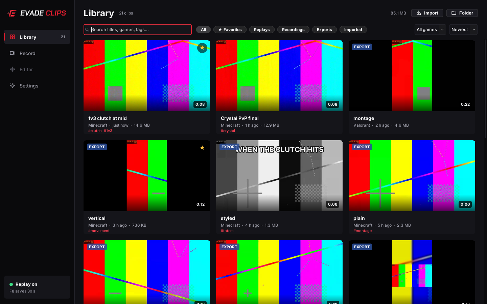

# Evade Clips

Record, store and edit gameplay clips. Evade Clips is a standalone desktop app for Windows, macOS and Linux. It
works with any game and has extra integration with Evade Client.



## Why it's different

- **Small files, guaranteed.** Every quality level has a hard bitrate ceiling, so busy footage (particles, rain,
  grass whipping past) can't balloon. Without a ceiling, a 1080p60 test came to 2.3 GB a minute; with one it's
  67 MB. HEVC is used automatically when your GPU supports it (38% smaller again). Calm scenes cost far less
  than the ceiling. Measured by `./gradlew :clips:sizeTest` (worst-case footage through the real engine):

  | 1080p60 | Small | Balanced | Best |
  |---|---|---|---|
  | worst case, MB/min (ceiling) | 39 (40) | 67 (68) | 113 (114) |
  | calm scene, MB/min | | 10 | |
  | a 30 s replay, worst case | 20 MB | 33 MB | 57 MB |

  The Record page shows the most a minute can cost with your settings. **Shrink** (right-click a clip)
  re-encodes old clips to HEVC and keeps every track, usually 40–60% smaller.
- **Zero cost when you're not playing.** Evade Clips detects running games and turns instant replay on when
  one starts and off when it closes. Any game in a Steam, Epic, Riot, Xbox/Game Pass, GOG, EA, Ubisoft,
  Rockstar or itch library is recognised by where it's installed, so detection never needs updates. A
  curated list covers popular games installed elsewhere, and Minecraft (any launcher) is recognised too. Clips
  are named after the game. Capture runs on the GPU's video encoder (NVENC, AMF, Quick Sync, VideoToolbox), so
  the game keeps its frames.
- **Game events, through official interfaces only** (no memory reading, nothing anti-cheat cares about):
  Counter-Strike 2 via Game State Integration (kills, headshots, 3K/4K/aces, MVPs, match wins; one-click
  setup), League of Legends via the Live Client API (kills, double…penta, aces, dragon/baron/herald steals,
  victory), and Minecraft via Evade Client (kills, multi-kills, totem pops, deaths, wins, advancements). Events
  close together become one clip ("Triple kill").
- **Share links and phone sync, no watermark, ads or expiry.** *Share link* uploads the clip with its edits
  and copies a link that plays inline in Discord. Every shared clip also lands in a private gallery you
  open on your phone by scanning a QR code; *Send to phone → Every new clip* syncs automatically. Links come
  from an [Evade Clips Share](../clips-share/README.md) server (a Cloudflare Worker + R2 anyone can deploy).
- **Named markers.** Every detected event and voice command drops a labelled bookmark ("Kill Steve", "ACE",
  "Death") on the timeline, so a full-match recording shows where everything happened. Deaths are marked,
  and optionally clipped.
- **Voice commands.** Say "clip that", "start recording", "stop recording" or "mark that". The words are
  recognised offline on your PC and nothing is sent anywhere. Only those exact phrases count, so callouts
  and chat don't trigger it.

- **Saving costs nothing.** Capture runs once into one-second segments that are already encoded, so saving a
  replay is a file copy that finishes instantly. While you play, saves never re-encode or stutter.
- **Replay and recording at the same time.** Starting a recording never restarts capture, so the replay buffer
  keeps running and a replay can be saved in the middle of a recording.
- **Recordings survive crashes.** A recording is written as you play and is playable at every moment. On stop
  it's converted to MP4.
- **Post-roll.** "Save the last 30 s **+5 s after**", so the clip shows what happened after you pressed the key.
- **Highlights in any game.** Fights are loud, so Evade Clips scans the audio for moments that stand out
  (shots, hits, explosions, your shouting) and marks them. One button (**H** in the editor) cuts a long
  recording down to just the action. New recordings are scanned automatically.
- **Auto-clips in Minecraft.** The **Clips** mod in Evade Client saves clips by itself on kills, totem pops,
  deaths and wins. Kills close together become one clip titled "Double kill", "Triple kill" and so on, tagged
  and named with the server.
- **Game, mic and voice chat on separate tracks.** You can turn your voice or your friends' voices down or
  off per clip without losing the game sound. Route your chat app to a virtual cable to give it its own track.
- **A real editor.** Trim, split, delete parts, slow-mo or speed-up any part (0.25×–4×), vertical/square
  framing with crop or blurred background (one click: *Make vertical*), zoom, timed captions (clean, subtitle or meme style), color looks
  (vibrant, cinematic with letterbox bars, black & white, retro, warm, cool) previewed live, fades, per-track
  volume, a title card, markers, frame grabs, and undo/redo for everything. Edits are non-destructive: the original is never touched.
- **Exports for where it's going.** Discord 10 MB and 50 MB (two-pass, guaranteed to fit), YouTube 1080p60,
  TikTok/Shorts/Reels 1080×1920, GIF, source quality, or an instant lossless trim.
- **Montages.** Select clips, right-click → *Make montage*. Each clip's edits are kept, and different sizes and
  frame rates are fitted to one canvas.
- **Local and private.** No account, no ads, no overlay injected into your game, no uploads. Your clips are
  plain MP4 files in a folder you choose, and the library index moves with the folder.
- **Fast to share.** Copy a clip (Ctrl+C) and paste it straight into Discord, or drag it out of the library.

## Using it

| Action | Default |
|---|---|
| Save the last 30 s | **F8** (anywhere, even in fullscreen games) |
| Start / stop recording | **F9** |
| Drop a marker | **F7** |

The editor is keyboard-first: **Space** play/pause, **←/→** frame step (Shift: 5 s), **J/L** ±2 s, **S** split,
**Delete** cut the part, **I/O** trim start/end, **H** highlight reel, **C** caption, **M** marker, **P** save the frame,
**Ctrl+Z/Y** undo/redo, **Ctrl+E** export, **Esc** back. Right-click the timeline to change a part's speed or
bring back a cut part. Ctrl+scroll zooms the timeline.

Library: search by title, game or tag; filter favorites, replays, recordings and exports; hover a clip to scrub
through it. Favorites are never auto-deleted when the storage limit is reached (the oldest replays go first).

## Local API

Evade Client and your own tools (scripts, stream decks) can drive Evade Clips on `http://127.0.0.1:47821`.
Requests from web pages are refused.

```
GET  /status
POST /clip?seconds=30&after=5&title=Ace&game=Valorant&tag=ace
POST /record/start   POST /record/stop   POST /record/toggle
POST /marker?label=Kill
POST /gsi/cs2        (CS2 Game State Integration, token-checked)
```

## Requirements

Java 17+ (the Minecraft Launcher's Java works) and **ffmpeg**:

- **Windows:** download a build from gyan.dev and put its `ffmpeg` folder next to Evade Clips (or on PATH).
  To record game audio, enable *Stereo Mix* or install VB-Cable. NVIDIA, AMD and Intel GPU encoders are
  picked up automatically.
- **macOS:** `brew install ffmpeg`. Install BlackHole to record game audio.
- **Linux:** install ffmpeg from your package manager. Desktop audio comes from PulseAudio/PipeWire.

## Building and testing

```bash
./gradlew :clips:jar                 # clips/build/libs/EvadeClips.jar
./gradlew :clips:createExe           # Evade-Clips.exe (Launch4j)
./gradlew :clips:selfTest            # headless end-to-end test, see below
./gradlew :clips:sizeTest            # file-size ceilings with worst-case footage
xvfb-run java -jar clips/build/libs/EvadeClips.jar --screenshots OUT   # render every page to PNG
```

`sizeTest` records worst-case footage at every quality and checks clips and exports stay under their
ceilings, that HEVC is smaller, and that Shrink keeps every track.

`selfTest` drives the real capture engine with ffmpeg's test pattern and two tones (game + mic). It checks
replays, markers, post-roll, recording during replay, the local API, every export preset (including the 10 MB
size limit and 1080×1920 vertical output), mic-track mixing, highlight detection on a clip with known loud
moments, a montage of differently sized clips, captions appearing only in their time range, effects,
three named audio tracks, named markers in replays and recordings, CS2 and League event payloads becoming the right clips, and game detection from
process paths and a live process. With a speech model (`CLIPS_VOSK_MODEL=...`) and espeak-ng it also
checks voice commands: spoken commands are heard (including over loud noise and in a UK voice), and
ordinary talking never triggers. With `CLIPS_SHARE_URL` pointing at a running share server (`npx wrangler dev`
in clips-share/) it also checks share links, embeds, byte ranges, the phone gallery, quotas and deleting.

## Layout

```
net.evadeclient.clips
├── ClipsApp / SelfTest
├── core/   CaptureEngine (segments → replays + recordings), CaptureSource (per-OS inputs), Library,
│           Clip, EditSpec, Exporter (presets, montage, shrink), Highlights, GameDetector, VoiceCommands,
│           Hotkeys, ControlServer, Ffmpeg, Settings
├── core/   CloudShare (share links + phone sync)
├── events/ AutoClipper (merges events into clips), Cs2Integration, LeagueIntegration
└── ui/     MainWindow, LibraryPanel, RecordPanel, EditorPanel, Timeline, VideoPlayer, SettingsPanel, Toast
```
